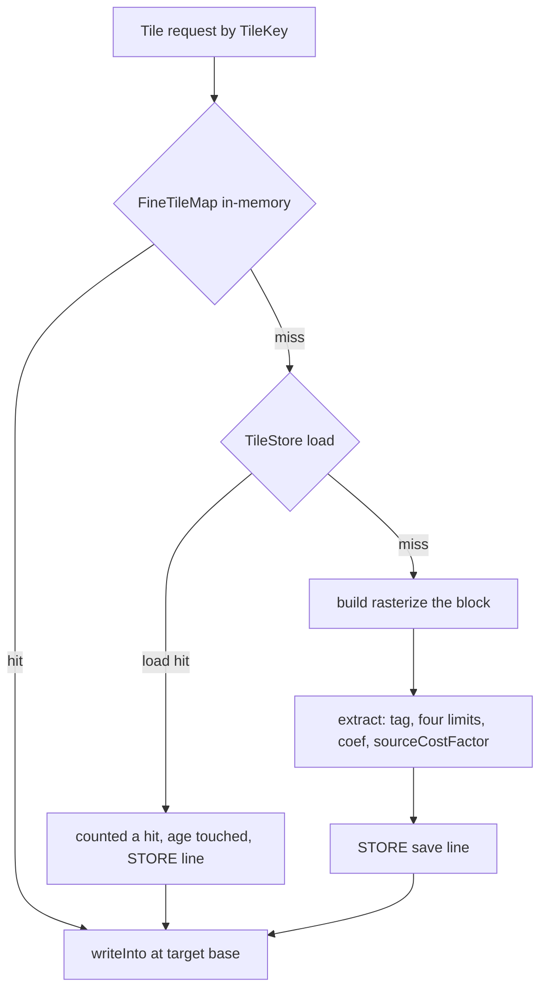

# FEAT_PLN_Route — Pace-free fine tiles, and the store's reading, ceiling and trim

**Date:** 2026-10-13 · **Status:** implemented · **Feature:** Route · **Order:** continues the fine-tile work, whose store already exists (canonical `TileKey` encoding, `FineTileCodec`, the pure [`TileStore`](../../app/src/main/java/ykws/android/maro/spatial/multipass/TileStore.kt) seam, [`FineTileMap`](../../app/src/main/java/ykws/android/maro/spatial/multipass/FineTileMap.kt) write-back, the process-level [`FineTileCache`](../../app/src/main/java/ykws/android/maro/spatial/multipass/FineTileCache.kt) holder and [`DirectoryFineTileStore`](../../app/src/main/java/ykws/android/maro/spatial/DirectoryFineTileStore.kt)).

**Out of scope, stated:** the background pre-warm is its own later task. No second invalidation mechanism is added — the key plus the entry's version number are the guard. No new dependency.

## 1 — The finding, grounded

A device pass proved the fine-layer **build** is the whole cold cost and near-nothing warm — **4225.6 ms cold against 10.6 ms warm** on `selective`. A tile is keyed on the cruising pace today, so one speed change expires every warmed tile.

A tile's **only** pace-dependent values are its one base scalar and its per-member source cost, and the latter is a multiple of the former:

- `baseCostSec(cellM, paceKn) = cellM / Units.knotsToMps(paceKn)` — [`RouteCostField.kt:102`](../../app/src/main/java/ykws/android/maro/spatial/multipass/RouteCostField.kt:102).
- The field opens every cell at that base and its sources **add** — [`MultipassGrid.addSourceCost`](../../app/src/main/java/ykws/android/maro/spatial/multipass/MultipassGrid.kt:302) does `cellSourceCostSec[i] += extraSec` over an array seeded at the base.
- The marker source's price is `markerPriceSec(baseCostSec, step, strength, factor) = baseCostSec × step × strength × factor` — [`RouteMarker.kt:119`](../../app/src/main/java/ykws/android/maro/spatial/multipass/RouteMarker.kt:119); the fine tile's field is built with `withZones = false`, `withBand = false` and `withDepthBand` defaulted `false`, so the marker price is the **only** soft source that reaches a fine tile's source cost — [`RoutePassPrimitives.kt:29`](../../app/src/main/java/ykws/android/maro/spatial/multipass/RoutePassPrimitives.kt:29) and [`RouteGridBuilder.kt:230`](../../app/src/main/java/ykws/android/maro/spatial/multipass/RouteGridBuilder.kt:230).
- So `sourceCostSec = baseCostSec × (1 + m)`, where `m` is the summed marker factor and is pace-free.
- Everything else a tile stores is already pace-free: the tag, the four limits (knots), the depth coefficient (a `0.0..1.0` ramp, **not** seconds) and the local index.

**Pace must reach neither the key nor the bytes.**

## 2 — What ships, and the decisions taken

**D1 · The tile stores a pace-free per-member factor.** `FineTile.sourceCostSec: DoubleArray` becomes `sourceCostFactor: DoubleArray` — the pace-free multiplier `f`, where the member's cost is `base × f`. `FineTile.baseCostSec` is **dropped**; `cellM` stays, and `byteSize` is unchanged (one double a member).

**D2 · The base is applied once, in one home.** A single function spells the member's cost:

```kotlin
fun memberCostAtBase(baseCostSec: Double, factor: Double): Double = baseCostSec * factor
```

`FineTile.writeInto` calls it with the **target grid's own base** (`target.baseCostSec`, the fine lattice's) and the member's pace-free factor. The shape also becomes `markerPriceSec(base, factor) = base * factor` (the pull's own read), because the base is now a single multiply, never an addition to re-spell. The build applies **no** pace base at all (D4), so there is no second addition to reconcile and no rounding trap to manage.

**D3 · The marker law keeps one home.** The loop that sums the well factor is lifted out of [`markerSources`](../../app/src/main/java/ykws/android/maro/spatial/multipass/RouteMarker.kt:137) into

```kotlin
fun markerFactorAt(markers: List<RouteMarker>, strength: Double, enabled: Boolean, p: LatLng): Double
```

and `markerSources`'s `priceSec` becomes `baseCostSec * markerFactorAt(...)`. The rasterizer and the tile's build then read one law, so the factor the field priced with and the factor the tile stores cannot disagree.

**D4 · The build stores the factor, not the seconds.** The tile is rasterized at a **unit base**: its own field's marker price is `1.0 × factor` and the raster's grid base is `1.0`, so `grid.sourceCostSec` **is** the pace-free multiplier `f = 1 + m` (and `1.0` on a marker-free member). [`FineTile.extract`](../../app/src/main/java/ykws/android/maro/spatial/multipass/FineTile.kt:116) reads it unchanged — no new parameter, no second per-member evaluation — and the pace never enters the tile's bytes. The marker law's one home still supplies that price; the tile's field is built by one small builder beside `costField`, and `rasterizeWindow` gains an optional base override used only here.

**D5 · The fine layer's own field.** Today the fine tile shares the **coarse** field (`costField(world, coarseCellM, …)`), so its marker price is charged at the coarse cell's base while its own cells open at the fine base — a latent inconsistency. The tile now gets its **own** marker field, and `writeInto` prices its water at the target's base (the fine lattice's), so one base governs the member's cost. Consequence, stated honestly: on a world **with priced markers** the fine layer's marker price moves from the coarse base to the fine base — a real (not ulp) move; on a marker-free world the water is byte-identical to today, and the coarse interior, the pull and their arithmetic are untouched. See §8.

**D6 · `paceKn` leaves [`TileKey`](../../app/src/main/java/ykws/android/maro/spatial/multipass/TileKey.kt:35).** The field, its `canonicalBytes` write, the group-3 KDoc sentence that names it, and [`fineTileKey`](../../app/src/main/java/ykws/android/maro/spatial/multipass/RouteGridBuilder.kt:514)'s `paceKn = pace` all go, so one tile serves every speed.

**D7 · The entry's version bumps, with no migration.** [`FineTileCodec.FORMAT_VERSION`](../../app/src/main/java/ykws/android/maro/spatial/multipass/FineTileCodec.kt:24) goes `1 → 2` and the body carries `sourceCostFactor` where it carried `sourceCostSec`. A mismatch is a **miss** and the file is deleted, never read as the new shape. Because D6 also renames every entry, an old file is orphaned rather than addressed; the disk trim reclaims those by age (§4).

**D8 · The disk ceiling.** A new key `route.fineTile.maxBytes=16777216` (16 MiB) in [`maro.properties`](../../app/src/main/assets/maro.properties:352), read through a new `AppConfig.routeFineTileMaxBytes`, replacing [`DirectoryFineTileStore.DEFAULT_MAX_BYTES`](../../app/src/main/java/ykws/android/maro/spatial/DirectoryFineTileStore.kt:94)'s hardcoded `64L * 1024L * 1024L`; [`MainActivity`](../../app/src/main/java/ykws/android/MainActivity.kt:95) passes it at the install. The in-memory ceiling (`FineTileMap.DEFAULT_MAX_BYTES`, 8 MiB) is a sibling and is untouched.

**D9 · The reclaim warning.** `DirectoryFineTileStore` reports its first reclamation once, with a fixed message in both locales (`startup_fine_tile_reclaimed`), surfaced in [`MainActivity`](../../app/src/main/java/ykws/android/MainActivity.kt:240) with the same `Toast` shape as `reportUnclaimedRouteEngineId`, plus a `MaroRoute` trace line. Because a reclaim happens during an arm, not at cold start, the store signals it through an injected `onReclaim` callback (once-guarded in the store) rather than a startup flag; the toast hops to the UI thread.

**D10 · The reading, the recency and the trim.**
- A store-served tile counts as a **hit** in `hitRate`: [`FineTileMap.get`](../../app/src/main/java/ykws/android/maro/spatial/multipass/FineTileMap.kt:87) counts a miss only when a **build** ran, so the builder's store hit must not leave the request counted a miss.
- One `STORE` trace line per load and per save, emitted through an injected sink so it stays inert off-device.
- Recency: a successful `load` **touches** the entry's `lastModified`, so oldest-first reclamation never evicts a tile a live arm still needs (the pre-warm's future case).
- Trim cost: the per-save whole-directory `sumOf { it.length() }` — O(n) each save, O(n²) once hundreds of tiles land — is replaced by an **incremental total**, primed once by a listing and adjusted on every save and delete.

## 3 — The arithmetic, and how it is proven

The re-application changes the order of operations, so a naive design — store the seconds, re-derive the factor by division, re-apply the base — would round differently across the grid on every cell, and an ulp is a potential line move this feature treats as user-visible. **The chosen design removes the reconciliation instead of managing it**: the tile stores a pace-free factor, the build applies no pace base, and the load applies the live base in one multiply (D2, D4). The proof below pins it.

The proof is a test, not an argument:

1. Build a tile at pace **A**, write it into a grid at A; write the same tile again at A. The two grids are **byte for byte** equal.
2. Build a tile at pace **A** and write it at pace **B**; build a tile at pace **B** and write it at B. The two grids are equal — because the stored factor is pace-free, the tiles are the same bytes.
3. Re-run the route **line fixtures** and record any move.

## 4 — The store, item by item

- **Version** — D7; `FineTileCodecTest` gains a "a v1 entry is refused, never read" case.
- **Ceiling** — D8; README/`SETUP` need no change beyond the key's comment in `maro.properties`.
- **Warning** — D9; the string joins both `strings.xml` locales.
- **Reading** — D10; `FineTileMapTest` pins "a store-served lookup counts a hit"; a store test pins one load line and one save line.
- **Recency** — D10; `DirectoryFineTileStoreTest` pins "a load updates the entry's age" (so a read tile outlives a written-then-unread one).
- **Trim** — D10; the incremental total is pinned by asserting the surviving set and that no full-directory sum is performed per save (a counting `File` seam, or the existing ceiling test extended to many saves).

## 5 — Blast radius

| Area | Files |
|---|---|
| The tile and its law | [`FineTile.kt`](../../app/src/main/java/ykws/android/maro/spatial/multipass/FineTile.kt), [`RouteMarker.kt`](../../app/src/main/java/ykws/android/maro/spatial/multipass/RouteMarker.kt), [`RouteCostField.kt`](../../app/src/main/java/ykws/android/maro/spatial/multipass/RouteCostField.kt) |
| The key and the codec | [`TileKey.kt`](../../app/src/main/java/ykws/android/maro/spatial/multipass/TileKey.kt), [`FineTileCodec.kt`](../../app/src/main/java/ykws/android/maro/spatial/multipass/FineTileCodec.kt) |
| The builder's seam | [`RouteGridBuilder.kt`](../../app/src/main/java/ykws/android/maro/spatial/multipass/RouteGridBuilder.kt) (`fineWindowGrid`, `buildFineTile`, `fineTileKey`) |
| The map and the store | [`FineTileMap.kt`](../../app/src/main/java/ykws/android/maro/spatial/multipass/FineTileMap.kt), [`DirectoryFineTileStore.kt`](../../app/src/main/java/ykws/android/maro/spatial/DirectoryFineTileStore.kt) |
| App edge and config | [`MainActivity.kt`](../../app/src/main/java/ykws/android/MainActivity.kt), [`AppConfig.kt`](../../app/src/main/java/ykws/android/maro/config/AppConfig.kt), [`maro.properties`](../../app/src/main/assets/maro.properties), both `strings.xml` |
| Tests | `TileTestFixtures`, `TileKeyTest`, `TileKeyCanonicalTest`, `FineTileCodecTest`, `FineTileExtractTest`, `FineTileMapTest`, `DirectoryFineTileStoreTest`, the route line fixtures |

**`spatial/multipass` stays pure Kotlin** — the file access stays behind `TileStore`, and the new trace/`onReclaim` sinks are injected at the app edge.

## 6 — Todo list

1. Recut `FineTile`: `sourceCostFactor` in place of `sourceCostSec`; drop `baseCostSec`; keep `cellM`.
2. Add `markerFactorAt` to `RouteMarker.kt`; make `markerPriceSec(base, factor) = base * factor`; route `markerSources` through `markerFactorAt`.
3. Add `memberCostAtBase(base, factor) = base * factor`; `FineTile.writeInto` computes each member's cost from the target's base and the stored factor.
4. Rasterize the tile at a unit base with a marker-unit field, so `extract` reads the pace-free factor from the grid unchanged; add `rasterizeWindow`'s optional base override.
5. Give the fine layer its own marker field, so one base governs the member's cost.
6. Drop `paceKn` from `TileKey`, its `canonicalBytes` and `fineTileKey`; trim the KDoc.
7. Bump `FineTileCodec.FORMAT_VERSION` to 2; encode/decode `sourceCostFactor`; no migration.
8. Update `TileTestFixtures` and every test that builds a `FineTile` or a `TileKey` flip list.
9. Add the byte-identity-at-A and equal-to-a-fresh-build-at-B proof, and a marker-factor `writeInto` case.
10. Re-run the route line fixtures; record any move the change causes.
11. Move the ceiling to `route.fineTile.maxBytes` (16 MiB) in `maro.properties`, through `AppConfig`, wired in `MainActivity`.
12. Add the reclaim warning: the store's once-flag and `onReclaim` sink, both locale strings, and the `MaroRoute` trace line.
13. Count a store-served lookup as a hit; print one `STORE` line per load and per save.
14. Touch the entry's age on a successful load.
15. Replace `trim`'s per-save whole-directory sum with an incremental total.
16. Green: `testDebugUnitTest` and `assembleDebug`.
17. Fold the landed facts into `FEAT_DSC_Route.md`, the engines doc and the feature state; move this plan to implemented.

## 7 — Acceptance

- The factoring proves byte-identity at the same pace and equality with a fresh build at another pace; the line fixtures hold.
- A served tile is byte-identical to a freshly built one; a version mismatch or a stamp change is a miss, never a stale tile; a partial store falls back to building.
- The disk ceiling is 16 MiB from `maro.properties`; a reclaim warns once in both locales.
- A store load reads as a hit; a load and a save each print one trace line.
- A loaded tile's age is refreshed; a save never sums the whole directory.
- `testDebugUnitTest` and `assembleDebug` green.

## 8 — What the design could not settle

- **The fine layer's marker base is a real move, not an ulp** (D5). Today the fine tile's marker price rides the coarse cell's base; `writeInto` now prices it at the fine cell's own base. On a world with priced markers the drawn line can move; on a marker-free world nothing moves. The user should rule whether the fine base is wanted — the brief's own wording (carry `cellM`, recompute from the live pace) says yes, and the fine base is the unit-consistent reading. Keeping today's coarse base would require carrying the base's cell in the tile, which contradicts the brief.
- **The warning's surfacing point** (D9): a reclaim happens mid-arm, so the message is raised then and hopped to the UI thread, not at cold start as the engine-id report is. If a cold-start-only report is wanted, the store would have to persist the fact, which is more machinery than the ask.
- **`hitRate` still has no production reader** (D67/F8). The task's "number to read" is satisfied by the new `STORE` lines; one arm-end cache line (`hits`/`misses`/`rate`/`bytes`) would close the older finding too, and is left out as beyond this ask.

## 9 — The tile's read and write path



## 10 — Docs and state to touch

- [`FEAT_DSC_Route.md`](FEAT_DSC_Route.md) tile bullet — the pace-free factor and the versioned store.
- [`FEAT_DOC_Route_engines.md`](FEAT_DOC_Route_engines.md) — the fine-layer tiles bullet.
- [`FEAT_HYD_Route.md`](FEAT_HYD_Route.md) — the state line and the next step.
