<!-- scope: feature -->
# Route — direction symmetry: one pair, one line

## Outcome

Settled in discussion on 2026-10-20: the route is directional by construction, and the user's bar is not
identity but **equivalence** — a search from A to B and from B to A over the same pair should land near
enough to make no real-world difference, which today is not the case. Seven stages read the line from one
end, six of them forward-looking. **Measured the same day over the baked region** (see *Measurement*), the
gap is not spread across them: it sits in the **pull**, in one **end that can be entered but not left**, and
— at the cheapest rung only — in the **search's cost**; the corner pass, the sweep and the straightener are
symmetric to under a metre when handed one line. The plan's repairs are re-ordered from that: the pull
first, the boxed end second, the other four dropped. The guaranteed-equality option — one fixed traversal
end — stands in reserve, declined by the user as a convention rather than a property.

**Date:** 2026-10-20 · **Status:** in design · **Order:** the user's word of 2026-10-20 — routes A→B and
B→A differ, which the user reads as the route not being optimised; scope is *similar enough to make no
real-world difference*, not absolute equality.

## The pipeline, in order

```mermaid
flowchart LR
  A[End repair] --> B[Grid build]
  B --> C[A search]
  C --> D[Pull 1 FWD]
  D --> E[Snap to corners]
  E --> F[Pull 2 FWD]
  F --> G[Fine pull FWD]
  G --> H[Fine snap]
  H --> I[Settled pull FWD]
  I --> J[Sweep FWD]
  J --> K[Straighten]
  K --> L[Corner pass FWD]
  L --> M[Profile clock]
  M --> N[Crown]
```

Forward-looking stages marked FWD: the four pulls, the sweep and the corner pass. A seventh, unmarked above,
is the corner pass's own pair-merge, `compoundLine` — a forward greedy that merges bends (1,2) one way and
(3,2) the other when three stand close together
([`RouteCornerPass.kt`](../../app/src/main/java/ykws/android/maro/spatial/multipass/RouteCornerPass.kt:279)).

## Why the two directions differ

Each stage's code-level reason, with what the instrument read for it:

- **The search is optimal up to ties — and not strictly direction-free in cost.** Each step is charged at
  the destination cell's rate over the step's length
  ([`MultipassSearch.kt`](../../app/src/main/java/ykws/android/maro/spatial/multipass/MultipassSearch.kt:359)),
  so reversing a chain prices each edge by its other neighbour; only the two end cells are the same.
  **Measured:** the cost is equal to three decimals on every λ 5 and λ 3 rung, and differs only on the
  cheapest rung through the Lérins channel (7.1 s, 0.62 % on `avoid`; 3.7 s, 0.35 % on `evolutive`). The
  chains themselves differ by up to 1 km on ties, which the pull absorbs.
- **The pull is a forward-only greedy** ([`MultipassPull.kt`](../../app/src/main/java/ykws/android/maro/spatial/multipass/MultipassPull.kt:466)):
  anchor and probe advance from the start and commit a waypoint at the first refused chord — the chord set
  is a function of the traversal order. **Measured: the address.** Handed one chain in both orientations,
  pull → snap → pull lands up to 116 m different in length on the Cap d'Antibes pair and up to ~2 km apart
  on the worst survey pair.
- **The sweep walks left to right to a fixpoint** ([`MultipassPull.kt`](../../app/src/main/java/ykws/android/maro/spatial/multipass/MultipassPull.kt:671))
  and **Douglas–Peucker keeps the first farthest vertex** on a strict `>`
  ([`MultipassPull.kt`](../../app/src/main/java/ykws/android/maro/spatial/multipass/MultipassPull.kt:536)).
  **Measured: symmetric.** The fine pass, sweep and straightener included, gives 0.0 m isolated on all 24
  survey pairs per plan (one named case 21.8 m). It is *not canonical*: it keeps two different pulled
  lines different, so the pull's gap passes through it.
- **The corner pass caps only the earlier bend of a pair** — `share[prevBend]` is written, the later bend's
  share stays `null` ([`RouteCornerPass.kt`](../../app/src/main/java/ykws/android/maro/spatial/multipass/RouteCornerPass.kt:373))
  — and the room also takes `emittedIn`, the distance the previous bow already emitted
  ([`RouteCornerPass.kt`](../../app/src/main/java/ykws/android/maro/spatial/multipass/RouteCornerPass.kt:481)).
  **Measured: 0.4 m** isolated on every pair (2.3 m worst) — the asymmetry is real in the code and below a
  metre on this coast's lines.
- **The aim's boxed test is an approximate reversal** — its entries read as reversed steps across the
  seam's one-way crossings ([`MultipassSearch.kt`](../../app/src/main/java/ykws/android/maro/spatial/multipass/MultipassSearch.kt:190)),
  so which end is held can flip with the direction. **Measured: a real failure.** On `evolutive`,
  napoule → cannes lands no line from A→B and three from B→A: the A end reads `startOpenSteps=0`
  (`expansions=1`) — it can be entered, never left.
- **The corner pass feeds the clock** — its `ceilingKnAt` goes into the profile
  ([`RouteAvoidEngine.kt`](../../app/src/main/java/ykws/android/maro/spatial/RouteAvoidEngine.kt:618)),
  so the asymmetry shows in minutes, not only in shape, and the crown ranks the drawn lines
  ([`RoutePassRanking.kt`](../../app/src/main/java/ykws/android/maro/spatial/multipass/RoutePassRanking.kt:1)).

## The verdict on "not optimised"

- **Half right.** The search is optimal; the optimum is then handed back by the four greedy drawing stages,
  so the *drawn* line can stand above it while the *search* cannot.
- **The score has no shape term** — trip time plus weighted slow seconds — so two lines of equal score are
  both optimal and the look alone proves non-uniqueness, never slack; only differing figures prove slack.

## Measurement (2026-10-20)

The instrument is [`RouteDirectionSymmetryTest`](../../app/src/test/java/ykws/android/maro/spatial/multipass/RouteDirectionSymmetryTest.kt)
over [`BakedRegionWorld`](../../app/src/test/java/ykws/android/maro/spatial/multipass/BakedRegionWorld.kt):
the baked `nice-menton` coastline, depth grid and speed zones, the shipped engine with both plans, the three
rungs at their shipped λ, 15 kn. It reports each stage twice — *end to end* and *isolated* (one input, both
orientations) — and writes `app/build/route-symmetry-report.txt` (five named pairs) and
`route-symmetry-survey.txt` (24 seeded pairs). It asserts nothing; run recipe in its KDoc. The bake is gitignored,
so it skips wherever the data is absent.

| Stage, isolated gap (m) | `avoid` | `evolutive` |
|---|---|---|
| search cost A→B vs B→A | equal at λ 5, 3; ±0.6 % at λ 1 in a channel | same |
| pull → snap → pull | 3 of 24 pairs over 100 m, max ~2180 | 2 of 24 over 100 m, max ~2130 |
| fine pass (sweep, DP, crossings) | 0.0 on all 24 | 0.0 on all 24 (one named case 21.8) |
| corner pass | max 0.4 | max 0.4 (2.3 in one named case) |
| engine line gap, worst rung | 4 of 24 over 100 m, max 298 | 2 of 24 over 100 m, max 297 |
| crown differs | 1 of 24 | 0 of 24 |
| misses the bar below | 3 of 24 | 2 of 24 |

Limits of the reading: 17 of the 24 random pairs are open-water straights, symmetric by construction, so the
rate is about the coast and not the sea; one pace; no costed markers; the stage tier restates
`RoutePassRunner.runPass`'s pull setup, so it drifts if that recipe moves; and `evolutive` lands no line in
either direction on survey pair 9, where `avoid` does — a robustness gap outside this plan.

## The compromise

- **Measure first — done**, above. Repairs are judged by re-running the same instrument: each must turn its
  own column down without moving the others, and the survey's bar misses must reach zero.
- **The bar:** same crowned rung, distance within one cell (100 m), ETA within
  `route.avoid.ladder.tieToleranceSec` (30 s) — an existing key, no new dial. The instrument prints it as
  `ok` / `GAP` per rung and `same` / `DIFF` for the crown.
- **Repair A — the pull made direction-free.** The address, and the only repair the measurement asks for
  outright. Two candidates were put to the user, who chose **the two-sided pull** on 2026-10-21 (the other
  was a canonical orientation, a narrower use of the reserved option below). Built as **best of both
  walks**, not a meet-in-the-middle rewrite: the path is pulled forward and, under the mirrored setup,
  backward, and the cheaper line wins, priced in a canonical direction so the caller's end never reaches the
  choice.
- **Repair 3 — the step back out of a fine copy.** Raised by the measurement: the one failure that costs the
  user a route (no line from A→B), napoule → cannes on `evolutive` its fixture. **Diagnosed 2026-10-21 as a
  different cause than this plan first named**: the `hasExit` approximation was not the culprit. A coarse
  cell steps into a neighbouring block's fine copy, and that copy had no step back, so an end standing on a
  copy walled in by land on the fine layer (`startOpenSteps=0`) could be entered but never left. The repair
  adds the reversed edge ([`WalkLattice.kt`](../../app/src/main/java/ykws/android/maro/spatial/multipass/WalkLattice.kt)
  `coarseNeighbourOfCopy`, read in `forEachStep`).
- **Repairs 1, 2, 4, 5 — dropped on the measurement.** Corner share and room (0.4 m), the straightener's tie
  and the sweep's snapshot (0.0 m on 24 pairs per plan) would change nothing the user can see on this coast.
  They stay recorded as real asymmetries in the code, to be reopened only by a pair the instrument shows
  them moving.
- **The search's cost at the cheapest rung** — pricing each edge at the mean of its two cells' rates — is not
  proposed: it would move every engine's answers, `avoid` included, for a 0.35–0.62 % cost gap seen once, in
  a channel, at λ 1. Open until a device pair shows it changing a crown.

## The search's tie-break (2026-10-21)

Ordered by the user on 2026-10-21 (`plan search tie break`) after the repairs above left 4 of 48 plan-pair
runs over the bar. **This is the reserved option, taken for the search alone.**

- **The cause, stated once.** An island on the line leaves two detours of equal cost; the A\* breaks the tie
  by `f`, then `g`, then slot index ([`MultipassSearch.kt`](../../app/src/main/java/ykws/android/maro/spatial/multipass/MultipassSearch.kt))
  from whichever end it starts, so A→B and B→A can take the two sides. The two-sided pull then keeps the
  cheaper of two pulls *of each chain*, which cannot reconcile two topologies.
- **The change.** The pass runs its search from a **canonical end**: of the two raw ends, the one that sorts
  first by latitude, then longitude. When that is the aim, the roles are swapped for the walk — the two cells,
  and the [`StepGuard`](../../app/src/main/java/ykws/android/maro/spatial/multipass/MultipassSearch.kt)'s two
  raw points, **together**, since the guard's end legs and the walk's `EndRule` slots must name the same end —
  and the cell path is reversed back before anything reads it. Both directions then run the one search, so they
  hand the pull one chain; the stages after it measured symmetric on one input over the 24-pair survey (pull
  0.0 m bar one `avoid` pair at 48 m, fine pass 0.0 m bar one named case at 21.8 m, corner pass 0.4 m bar one
  named case at 2.3 m), which is the claim this change is judged on, not a proof for tie fixtures.
  Where it lives: [`RoutePassRunner.runPass`](../../app/src/main/java/ykws/android/maro/spatial/multipass/RoutePassRunner.kt),
  the one caller that builds the guard and names the ends, through **one small internal function** a test can
  call without a `GridContext`; `MultipassSearch.searchWalk` stays role-neutral, its direct callers
  (`GateEndStepTest`, `DirectionSymmetryRepairsTest`, `RouteFinePass`'s local re-solves, the forced-crossing
  probe) untouched.
- **One home for the rule.** The canonical direction is already written in
  [`MultipassPull.canonicalDirection`](../../app/src/main/java/ykws/android/maro/spatial/multipass/MultipassPull.kt)
  (private, latitude then longitude, `<=` keeping the order). It becomes one internal predicate on two points
  that both the pull and the search read, so the two cannot disagree about which end is first.
- **A fallback, because the graph is not perfectly reversible.** Seam crossings are one-way in places
  (`crossLayerSlots` redirects a face cell to a neighbouring block's fine copy; a copy is not on a face), and
  the held-end test reads the aim's entries as reversed steps. So a pair routable in only one orientation could
  fail in both under a fixed canonical end — and the end that sorts first is the one the napoule → cannes pair
  failed from. **When the canonical search lands no path, the natural orientation is walked once**
  (`reversed = false`); on success, which is nearly always, no second search runs.
- **What it costs, honestly.**
  - *The edge price is the destination cell's rate* — the zone, limit and berth prices included, and a seam
    edge by its centre distance, so a coarse → fine step pays the fine rate and fine → coarse the coarse one. A
    reversed walk therefore prices each edge by its other neighbour, at any λ and not only the λ 1 channel
    where 0.35–0.62 % was measured. A route is planned on the price the *reverse* trip would pay in the pairs
    whose canonical end is the aim. That is the convention the user accepted.
  - *The ends' rules follow the canonical end, not the boat.* The held-start and held-aim readings
    (`strictStart`, `strictAim`, `hasExit`) swap with the roles. The geometry they test is symmetric, and a
    false "has an exit" is caught (the refused step is recorded and the waived re-walk triggers), a false
    "no exit" only waives — an extra re-walk at worst, not a lost route.
  - *Gate legs.* `keepsWall` cuts its pieces from the segment's first point, so a step's verdict near the
    waiver rim can differ by one fine sample per direction; the pull re-checks, so it is harmless.
  - *Diagnostics speak of the canonical frame.* `strictStart`, `strictAim`, `startLayer` and `startOpenSteps`
    describe the end the walk left. `SearchOutcome` gains a `reversed` flag (set by `runPass`, never by
    `searchWalk`) and the `NO PATH` trace prints it with the walk's own end cells, so the `aimCell` and
    `aimLimit` it names and the counts beside them are of one end.
  - *No extra work on success.* One search, as before; a second only when the canonical one lands no path.
- **Not touched.** The fine pass's local re-solves (bound ends, orientation by the line, already 0.0 m
  isolated), the clock and the speed profile (they run along the real travel direction, so deceleration and
  acceleration stay physically ordered), and the pull, which keeps both walks.
- **Success is the instrument's.** The survey's bar misses (`avoid` 2, `evolutive` 2 of 24) go to zero, the
  named pairs' crown flips go, no pair gets worse than it is, the engine suite stays green, and
  **napoule → cannes still routes on `evolutive` in both directions** — its first-sorting end is the one that
  failed before the fine copy's step back, so it is the case the swap could break.
- **A test shown red first.** The fixture is a single-layer `MultipassGrid` with `markLand` blocks as an
  island, handed to the swap function with a gate taken from `GateTestFixtures.gateOver` over a deep
  `RasterWorld` (a `null` gate skips the guard altogether; over uniform deep water it never refuses a step, so
  the guard's *swap* is carried by the instrument and the review, not pinned by this test). A tie is not guaranteed by
  symmetry alone — the search resolves ties by first arrival, ordered by `f = g + h` with `h` the haversine to
  the aim, and the `cos φ` term can make both directions pick the same side — so the test loops several
  island offsets and diagonal end placements and **first asserts the precondition**: for at least one fixture
  the plain search from A and the reverse of the plain search from B disagree. If no fixture shows that, the
  test is not red on the old code and the plan says so rather than pretending. Then it asserts the swap
  returns one chain from both ends, and the walled-copy fixture of `DirectionSymmetryRepairsTest` is run
  through it (without a gate, and without asserting which end sorts first).
- **Strongest objection.** Symmetry bought by convention hides, rather than removes, the search's real
  directional pricing: if the destination-rate law ever grows (a one-way water, a current), the canonical end
  would price it wrongly in half the pairs. After this change both directions report the *same* walk's
  `costSec`, so the instrument's cost column reads zero by construction and is no tripwire; one that catches
  the law moving would have to price the natural orientation separately, and is not part of this change.

## Reserved option

- One fixed traversal end makes both directions byte-identical in one decision, at the cost of being a
  convention and of binding the boat-side end's water to the canonical end's rule. Declined by the user on
  2026-10-20 for the whole pipeline; **taken for the search alone on 2026-10-21** (above). The pull, which
  already keeps both walks, and the later stages are not bound to it.

## Open questions

- What does *equivalent* mean in numbers — the same crowned rung, the distance, the ETA, or all three? The
  instrument currently prints all three against the bar above (100 m, 30 s, same crown); the user's word on
  the bar is still owed. A crown flip between two lines inside the 30 s tolerance may not be a defect.
- **Newly open, from the repairs' measurement:** the pairs still over the bar differ because the A\*'s two
  cell chains differ on cost ties, so the pull is handed two different inputs and picks two near-equal
  topologies (for instance either side of an island). **Answered 2026-10-21:** the search runs from a
  canonical end — see *The search's tie-break*.
- ~~Is a canonical orientation acceptable for the pull alone, or must the pull become two-sided?~~ Answered
  2026-10-21: two-sided.
- **Closed by the measurement:** whether repairs 4–5 are justified (no — isolated 0.0 m) and whether the
  corner pass is the real-world difference (no — 0.4 m).
- **Newly open:** `evolutive` lands no line either way on survey pair 9; and the survey needs more
  obstacle-bearing pairs and a second pace before the 3-of-24 rate is trusted as a rate.

## Relation to the earlier plan

The 2026-10-13 bend work ([`261007_FEAT_PLN_Route_turn-impact-and-symmetry.md`](261007_FEAT_PLN_Route_turn-impact-and-symmetry.md))
fixed a bend's reach and floor in size; this plan fixes the line in the order it is drawn, the half that
plan's `## Outcome` never reached.

## Implemented

**2026-10-21 · `feature/route-sym-2` · repair 3 and repair A, on the user's `#impl` and the choice of the two-sided pull.**

- **The step back out of a fine copy** — `WalkWindows.isFineCopyCell` and `coarseNeighbourOfCopy`, read in
  `MultipassSearch.forEachStep` after the seam: the exact reverse of the coarse-to-copy step (same eight steps,
  same two-centre length, a superseded coarse cell no target). `avoid`'s single grid is untouched.
- **The two-sided pull** — `MultipassPull.pullBothWays` over `PullSetup.reversed()`, called by
  `RoutePassRunner.runPass` for both of its pulls; the fine pass and local re-solves stay forward-only, their
  taut lines being fixed points (0.0 m isolated).
- **Tests** — `DirectionSymmetryRepairsTest`: the walled copy is routable both ways (red without the
  back-edge), the back-edge mirrors the forward edge at ratios 5, 2 and 10, and the two-sided pull returns one
  line from either end and never one longer than either single pull, by length and by priced seconds.
  `RouteDirectionSymmetryTest` and `BakedRegionWorld` are the instrument, gated by `-Dmaro.prebake=true`.
- **Build** — the whole `testDebugUnitTest` suite green and `assembleDebug` packaged; no dependency added; the
  device pass is the user's.

**Measured after** (same 24 seeded pairs and 5 named, 15 kn): isolated pull gap 0.0 m everywhere but one `avoid`
pair (48 m, the corner snap between the two pulls); napoule → cannes on `evolutive` now lands a line from both
ends; the cannes-bay → baie-des-anges pair's end-to-end gap fell from 116 m to 25 m on `avoid`. **The bar is not
met**: pairs missing it went 5 → 4 over the two plans, and on three pair-runs the gap grew (`avoid` pair 23
298 → 985 m, `evolutive` pair 22 101 → 583 m and pair 23 297 → 747 m) where the two chains pick different
near-equal topologies. Each of those is a cost near-tie (ETA gap 4–59 s) the pull cannot reconcile.

**Ask hop:** no blocking finding. Taken: the `searchWalk` KDoc names the way back; the back-edge test now
covers odd and even ratios; the pull test runs with and without a pace so the priced branch is read. Left:
`landRefusals`/`priceRefusals` in the engine's `DEVICE PASS` trace now count both walks; the sweep's
"no refusals" gate opens a little more often; each pass pays four pulls where it paid two — compare `PULL ms`
and `FINAL ms` on a device pair; `hasExit`'s "approximate" KDoc is a little stale for a coarse end beside a copy.

### The search's tie-break (2026-10-20, `feature/route-sym-2`)

**Shipped on the user's `#impl`, after `plan search tie break` and a review of the plan** (the review's
blocking points — a fallback walk, a one-home rule, a stale tripwire claim, a fixture shown red first — are in
the plan section above).

- **`RoutePassRunner.searchFromCanonicalEnd`** — the pass's one search now leaves the end that
  [`sortsFirst`](../../app/src/main/java/ykws/android/maro/spatial/multipass/RoutePassPrimitives.kt), the cells
  and the guard's two points swapped together, the cell path turned back to the caller's direction; a walk that
  lands no path is walked once the other way, in the same order from either end. `MultipassPull`'s canonical
  direction reads the same predicate. `SearchOutcome.reversed` and the `NO PATH` trace's `reversed=` and
  walk-side aim cell say which end a walk left.
- **Tests** — `SearchCanonicalEndTest`: over twelve island fixtures with a gate, the plain search disagrees
  with itself on at least one (the precondition, so the test is red on the code it replaces) and the canonical
  one never does; the outcome's `reversed` is false for the western start and true for the eastern; a copy
  walled in by land routes both ways as one chain.
- **Measured after** (the same 24 seeded pairs and 5 named, 15 kn): pairs over the bar **4 → 0** across both
  plans; the engine's line gap, worst rung, **median 0.0 m, max 0.4 m** (was 298 / 985 m); crown flips 0 of 48
  in the survey; napoule → cannes routes on `evolutive` from both ends; no pair got worse. The whole unit
  suite is green and `assembleDebug` packaged.
- **One residue:** cannes-bay → baie-des-anges on `evolutive` still crowns `fast` one way and `around` the
  other, on lines equal to 0.4 m and ETAs 2.3 s apart inside the 30 s tolerance — the ranking's own near-tie,
  not geometry.
- **Ask hop:** no blocking finding. Taken: a fallback now sums both walks' expansions; the `reversed`
  assertion is exact. Left, stated: the guard's swap and the fallback have no unit test (the first needs an end
  near a wall, the second a one-way crossing); the `LINE` trace's `strictStart` / `strictAim` are in the walk's
  frame without saying so; a failing pair now costs up to four exhaustive walks instead of two (eight with the
  engine's grown-corridor retry) — latency on failing pairs only.

### What the symmetry costs (2026-10-21)

Measured with a throw-away timing probe (engine API only, so it ran on both trees) over 12 pairs, both
directions, median of three, desktop JVM, real baked region, 15 kn, against the commit before the work
(`6dfc6cbc`). Per plan, 24 ladders: `avoid` wall time **6.9 s → 11.3 s (+64 %)**, `evolutive` **24.3 s →
43.4 s (+79 %)**. The pull went ×2.05 (3.95 → 8.10 s and 17.9 → 36.5 s) and equals the whole rise of the coarse
pass, since the pull was already 75–90 % of it; the canonical-end search and the fine copy's step back add
nothing measurable, and the fine pass and corner pass are unchanged. About 0.29 → 0.47 s a ladder on `avoid`,
1.0 → 1.8 s on `evolutive`. Desktop time, not phone time: the ratio travels, and the device's `PULL ms` /
`FINAL ms` are the real check. A pair with no path walks up to four searches instead of two.
