<!-- scope: feature -->
# Route — direction symmetry: one pair, one line

## Outcome

Settled in discussion on 2026-10-20: the route is directional by construction, and the user's bar is not
identity but **equivalence** — a search from A to B and from B to A over the same pair should land near
enough to make no real-world difference, which today is not the case. Seven stages read the line from one
end, six of them forward-looking. **Measured the same day over the baked region** (see *Measurement*), the
gap is not spread across them: it sits in the **pull**, in one **end that can be entered but not left**, and
— at the cheapest rung only — in the **search's cost**; the corner pass, the sweep and the straightener are
symmetric to under a metre when handed one line. The plan's repairs are re-ordered from that: the pull
first, the boxed end second, the other four dropped. The guaranteed-equality option — one fixed traversal
end — stands in reserve, declined by the user as a convention rather than a property.

**Date:** 2026-10-20 · **Status:** in design · **Order:** the user's word of 2026-10-20 — routes A→B and
B→A differ, which the user reads as the route not being optimised; scope is *similar enough to make no
real-world difference*, not absolute equality.

## The pipeline, in order

```mermaid
flowchart LR
  A[End repair] --> B[Grid build]
  B --> C[A search]
  C --> D[Pull 1 FWD]
  D --> E[Snap to corners]
  E --> F[Pull 2 FWD]
  F --> G[Fine pull FWD]
  G --> H[Fine snap]
  H --> I[Settled pull FWD]
  I --> J[Sweep FWD]
  J --> K[Straighten]
  K --> L[Corner pass FWD]
  L --> M[Profile clock]
  M --> N[Crown]
```

Forward-looking stages marked FWD: the four pulls, the sweep and the corner pass. A seventh, unmarked above,
is the corner pass's own pair-merge, `compoundLine` — a forward greedy that merges bends (1,2) one way and
(3,2) the other when three stand close together
([`RouteCornerPass.kt`](../../app/src/main/java/ykws/android/maro/spatial/multipass/RouteCornerPass.kt:279)).

## Why the two directions differ

Each stage's code-level reason, with what the instrument read for it:

- **The search is optimal up to ties — and not strictly direction-free in cost.** Each step is charged at
  the destination cell's rate over the step's length
  ([`MultipassSearch.kt`](../../app/src/main/java/ykws/android/maro/spatial/multipass/MultipassSearch.kt:359)),
  so reversing a chain prices each edge by its other neighbour; only the two end cells are the same.
  **Measured:** the cost is equal to three decimals on every λ 5 and λ 3 rung, and differs only on the
  cheapest rung through the Lérins channel (7.1 s, 0.62 % on `avoid`; 3.7 s, 0.35 % on `evolutive`). The
  chains themselves differ by up to 1 km on ties, which the pull absorbs.
- **The pull is a forward-only greedy** ([`MultipassPull.kt`](../../app/src/main/java/ykws/android/maro/spatial/multipass/MultipassPull.kt:466)):
  anchor and probe advance from the start and commit a waypoint at the first refused chord — the chord set
  is a function of the traversal order. **Measured: the address.** Handed one chain in both orientations,
  pull → snap → pull lands up to 116 m different in length on the Cap d'Antibes pair and up to ~2 km apart
  on the worst survey pair.
- **The sweep walks left to right to a fixpoint** ([`MultipassPull.kt`](../../app/src/main/java/ykws/android/maro/spatial/multipass/MultipassPull.kt:671))
  and **Douglas–Peucker keeps the first farthest vertex** on a strict `>`
  ([`MultipassPull.kt`](../../app/src/main/java/ykws/android/maro/spatial/multipass/MultipassPull.kt:536)).
  **Measured: symmetric.** The fine pass, sweep and straightener included, gives 0.0 m isolated on all 24
  survey pairs per plan (one named case 21.8 m). It is *not canonical*: it keeps two different pulled
  lines different, so the pull's gap passes through it.
- **The corner pass caps only the earlier bend of a pair** — `share[prevBend]` is written, the later bend's
  share stays `null` ([`RouteCornerPass.kt`](../../app/src/main/java/ykws/android/maro/spatial/multipass/RouteCornerPass.kt:373))
  — and the room also takes `emittedIn`, the distance the previous bow already emitted
  ([`RouteCornerPass.kt`](../../app/src/main/java/ykws/android/maro/spatial/multipass/RouteCornerPass.kt:481)).
  **Measured: 0.4 m** isolated on every pair (2.3 m worst) — the asymmetry is real in the code and below a
  metre on this coast's lines.
- **The aim's boxed test is an approximate reversal** — its entries read as reversed steps across the
  seam's one-way crossings ([`MultipassSearch.kt`](../../app/src/main/java/ykws/android/maro/spatial/multipass/MultipassSearch.kt:190)),
  so which end is held can flip with the direction. **Measured: a real failure.** On `evolutive`,
  napoule → cannes lands no line from A→B and three from B→A: the A end reads `startOpenSteps=0`
  (`expansions=1`) — it can be entered, never left.
- **The corner pass feeds the clock** — its `ceilingKnAt` goes into the profile
  ([`RouteAvoidEngine.kt`](../../app/src/main/java/ykws/android/maro/spatial/RouteAvoidEngine.kt:618)),
  so the asymmetry shows in minutes, not only in shape, and the crown ranks the drawn lines
  ([`RoutePassRanking.kt`](../../app/src/main/java/ykws/android/maro/spatial/multipass/RoutePassRanking.kt:1)).

## The verdict on "not optimised"

- **Half right.** The search is optimal; the optimum is then handed back by the four greedy drawing stages,
  so the *drawn* line can stand above it while the *search* cannot.
- **The score has no shape term** — trip time plus weighted slow seconds — so two lines of equal score are
  both optimal and the look alone proves non-uniqueness, never slack; only differing figures prove slack.

## Measurement (2026-10-20)

The instrument is [`RouteDirectionSymmetryTest`](../../app/src/test/java/ykws/android/maro/spatial/multipass/RouteDirectionSymmetryTest.kt)
over [`BakedRegionWorld`](../../app/src/test/java/ykws/android/maro/spatial/multipass/BakedRegionWorld.kt):
the baked `nice-menton` coastline, depth grid and speed zones, the shipped engine with both plans, the three
rungs at their shipped λ, 15 kn. It reports each stage twice — *end to end* and *isolated* (one input, both
orientations) — and writes `app/build/route-symmetry-report.txt` (five named pairs) and
`route-symmetry-survey.txt` (24 seeded pairs). It asserts nothing; run recipe in its KDoc. The bake is gitignored,
so it skips wherever the data is absent.

| Stage, isolated gap (m) | `avoid` | `evolutive` |
|---|---|---|
| search cost A→B vs B→A | equal at λ 5, 3; ±0.6 % at λ 1 in a channel | same |
| pull → snap → pull | 3 of 24 pairs over 100 m, max ~2180 | 2 of 24 over 100 m, max ~2130 |
| fine pass (sweep, DP, crossings) | 0.0 on all 24 | 0.0 on all 24 (one named case 21.8) |
| corner pass | max 0.4 | max 0.4 (2.3 in one named case) |
| engine line gap, worst rung | 4 of 24 over 100 m, max 298 | 2 of 24 over 100 m, max 297 |
| crown differs | 1 of 24 | 0 of 24 |
| misses the bar below | 3 of 24 | 2 of 24 |

Limits of the reading: 17 of the 24 random pairs are open-water straights, symmetric by construction, so the
rate is about the coast and not the sea; one pace; no costed markers; the stage tier restates
`RoutePassRunner.runPass`'s pull setup, so it drifts if that recipe moves; and `evolutive` lands no line in
either direction on survey pair 9, where `avoid` does — a robustness gap outside this plan.

## The compromise

- **Measure first — done**, above. Repairs are judged by re-running the same instrument: each must turn its
  own column down without moving the others, and the survey's bar misses must reach zero.
- **The bar:** same crowned rung, distance within one cell (100 m), ETA within
  `route.avoid.ladder.tieToleranceSec` (30 s) — an existing key, no new dial. The instrument prints it as
  `ok` / `GAP` per rung and `same` / `DIFF` for the crown.
- **Repair A — the pull made direction-free.** The address, and the only repair the measurement asks for
  outright. Two candidates were put to the user, who chose **the two-sided pull** on 2026-10-21 (the other
  was a canonical orientation, a narrower use of the reserved option below). Built as **best of both
  walks**, not a meet-in-the-middle rewrite: the path is pulled forward and, under the mirrored setup,
  backward, and the cheaper line wins, priced in a canonical direction so the caller's end never reaches the
  choice.
- **Repair 3 — the step back out of a fine copy.** Raised by the measurement: the one failure that costs the
  user a route (no line from A→B), napoule → cannes on `evolutive` its fixture. **Diagnosed 2026-10-21 as a
  different cause than this plan first named**: the `hasExit` approximation was not the culprit. A coarse
  cell steps into a neighbouring block's fine copy, and that copy had no step back, so an end standing on a
  copy walled in by land on the fine layer (`startOpenSteps=0`) could be entered but never left. The repair
  adds the reversed edge ([`WalkLattice.kt`](../../app/src/main/java/ykws/android/maro/spatial/multipass/WalkLattice.kt)
  `coarseNeighbourOfCopy`, read in `forEachStep`).
- **Repairs 1, 2, 4, 5 — dropped on the measurement.** Corner share and room (0.4 m), the straightener's tie
  and the sweep's snapshot (0.0 m on 24 pairs per plan) would change nothing the user can see on this coast.
  They stay recorded as real asymmetries in the code, to be reopened only by a pair the instrument shows
  them moving.
- **The search's cost at the cheapest rung** — pricing each edge at the mean of its two cells' rates — is not
  proposed: it would move every engine's answers, `avoid` included, for a 0.35–0.62 % cost gap seen once, in
  a channel, at λ 1. Open until a device pair shows it changing a crown.

## Reserved option

- One fixed traversal end makes both directions byte-identical in one decision, at the cost of being a
  convention and of binding the boat-side end's water to the canonical end's rule. Declined by the user;
  kept as the fallback if the measured repairs do not reach the bar.

## Open questions

- What does *equivalent* mean in numbers — the same crowned rung, the distance, the ETA, or all three? The
  instrument currently prints all three against the bar above (100 m, 30 s, same crown); the user's word on
  the bar is still owed. A crown flip between two lines inside the 30 s tolerance may not be a defect.
- **Newly open, from the repairs' measurement:** the pairs still over the bar differ because the A\*'s two
  cell chains differ on cost ties, so the pull is handed two different inputs and picks two near-equal
  topologies (for instance either side of an island). A symmetric tie-break — the search run from a canonical
  end — would close it, and is the declined fixed-end option applied to the search alone, binding the boat-side
  end's rule to the canonical end's. The user's call.
- ~~Is a canonical orientation acceptable for the pull alone, or must the pull become two-sided?~~ Answered
  2026-10-21: two-sided.
- **Closed by the measurement:** whether repairs 4–5 are justified (no — isolated 0.0 m) and whether the
  corner pass is the real-world difference (no — 0.4 m).
- **Newly open:** `evolutive` lands no line either way on survey pair 9; and the survey needs more
  obstacle-bearing pairs and a second pace before the 3-of-24 rate is trusted as a rate.

## Relation to the earlier plan

The 2026-10-13 bend work ([`261007_FEAT_PLN_Route_turn-impact-and-symmetry.md`](261007_FEAT_PLN_Route_turn-impact-and-symmetry.md))
fixed a bend's reach and floor in size; this plan fixes the line in the order it is drawn, the half that
plan's `## Outcome` never reached.

## Implemented

**2026-10-21 · `feature/route-sym-2` · repair 3 and repair A, on the user's `#impl` and the choice of the two-sided pull.**

- **The step back out of a fine copy** — `WalkWindows.isFineCopyCell` and `coarseNeighbourOfCopy`, read in
  `MultipassSearch.forEachStep` after the seam: the exact reverse of the coarse-to-copy step (same eight steps,
  same two-centre length, a superseded coarse cell no target). `avoid`'s single grid is untouched.
- **The two-sided pull** — `MultipassPull.pullBothWays` over `PullSetup.reversed()`, called by
  `RoutePassRunner.runPass` for both of its pulls; the fine pass and local re-solves stay forward-only, their
  taut lines being fixed points (0.0 m isolated).
- **Tests** — `DirectionSymmetryRepairsTest`: the walled copy is routable both ways (red without the
  back-edge), the back-edge mirrors the forward edge at ratios 5, 2 and 10, and the two-sided pull returns one
  line from either end and never one longer than either single pull, by length and by priced seconds.
  `RouteDirectionSymmetryTest` and `BakedRegionWorld` are the instrument, gated by `-Dmaro.prebake=true`.
- **Build** — the whole `testDebugUnitTest` suite green and `assembleDebug` packaged; no dependency added; the
  device pass is the user's.

**Measured after** (same 24 seeded pairs and 5 named, 15 kn): isolated pull gap 0.0 m everywhere but one `avoid`
pair (48 m, the corner snap between the two pulls); napoule → cannes on `evolutive` now lands a line from both
ends; the cannes-bay → baie-des-anges pair's end-to-end gap fell from 116 m to 25 m on `avoid`. **The bar is not
met**: pairs missing it went 5 → 4 over the two plans, and on three pair-runs the gap grew (`avoid` pair 23
298 → 985 m, `evolutive` pair 22 101 → 583 m and pair 23 297 → 747 m) where the two chains pick different
near-equal topologies. Each of those is a cost near-tie (ETA gap 4–59 s) the pull cannot reconcile.

**Ask hop:** no blocking finding. Taken: the `searchWalk` KDoc names the way back; the back-edge test now
covers odd and even ratios; the pull test runs with and without a pace so the priced branch is read. Left:
`landRefusals`/`priceRefusals` in the engine's `DEVICE PASS` trace now count both walks; the sweep's
"no refusals" gate opens a little more often; each pass pays four pulls where it paid two — compare `PULL ms`
and `FINAL ms` on a device pair; `hasExit`'s "approximate" KDoc is a little stale for a coarse end beside a copy.
