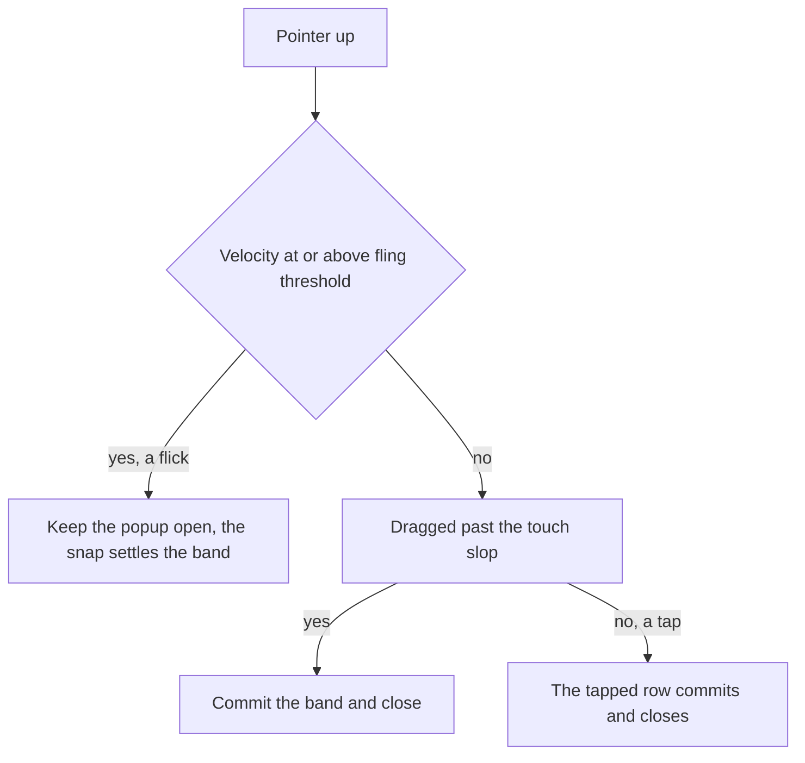

# FEAT_PLN Ui_General — the dropdown wheel keeps a flick open

**Feature:** Ui_General · **Date:** 2026-10-21 · **Branch:** `feature/wheel-launch` · **Status:** implemented — build and scoped suite green; the device pass is owed
**Owner surface:** the one dropdown control — [`DropdownRow`](../../app/src/main/java/ykws/android/maro/ui/components/DropdownRow.kt:87) with its popup body [`DropdownWheel`](../../app/src/main/java/ykws/android/maro/ui/components/DropdownWheel.kt:75) and the pure arithmetic in [`WheelPolicy`](../../app/src/main/java/ykws/android/maro/ui/components/WheelPolicy.kt:1).

## 1. The order, as given

The user's word (2026-10-21), then the fork it closed:

1. "Right now, on finger up it closes and updates, which makes it difficult to use on long lists."
2. "If the finger lifts on a flick, then it doesn't close."
3. Asked how iOS's wheel handles the same case — its answer is *commit on settle, never on lift, and never close* — the choice came back as the middle path: **velocity-gated release**. A flick keeps the wheel open and lets its snap settle; a non-flick lift keeps today's commit-and-close.

The first pass is scoped to the wheel's own gestures **inside the popup**; the box's opening drag stays as it is (§7).

## 2. What the control does today

The commit-on-release rule is single-sourced in
[`261017_FEAT_PLN_Ui_General_wheel-commit-on-release.md`](261017_FEAT_PLN_Ui_General_wheel-commit-on-release.md) §3.

| Door | Today |
|---|---|
| A row tap inside the popup | writes that row and closes |
| A drag or fling inside the popup | the wheel's own Final-pass observer commits the band and closes at pointer-up |
| A vertical drag begun on the box | opens, scrolls the hoisted wheel, commits the band and closes at `onDragEnd` |
| An outside tap | commits the band and closes |
| Back | closes with no write |
| A cancelled drag | closes with no write |

The fling is dead weight today: `rememberSnapFlingBehavior` is attached to the wheel's `LazyColumn`, but
the close at pointer-up cuts the fling before it can run — review finding S-2 in the commit-on-release plan §8.

## 3. The rule that replaces them

The release splits by velocity, and only the split changes.

| Gesture | Behaviour |
|---|---|
| Flick — release velocity ≥ the platform fling threshold | no commit, no close; the wheel's own snap carries the list and settles the band; the popup stays open |
| Non-flick lift — a drag that stops, then lifts below the threshold | commit the band and close — today's "set on release" |
| Tap on a row | commit that row and close (the degenerate release) |
| Outside tap | commit the band and close (the scrim means the banded row) |
| Back | close, no write |
| Cancelled drag | close, no write |



Consequences to name rather than hide:

- **The band is a candidate again while browsing** — but only after a flick. The box keeps its committed value
  until the next commit gesture; the band covers the box while the popup is open, so the difference is in state and surfaces only when a back-cancel reverts the box to its committed value. That is the exact
  cost the 2026-10-17 order paid to remove; it returns scoped to the flick path.
- **Back becomes a real cancel in the browse state**: after a flick, back closes without a write and discards the
  band's candidate — the one cancel the commit-on-release rule had removed.
- **The snap becomes live again.** `rememberSnapFlingBehavior` stops being dead weight (S-2 inverted): a flick no
  longer closes the popup, so the list's own fling-and-snap settles the band. No new scroll code is written.

## 4. Mechanism

- **One pure helper** in [`WheelPolicy`](../../app/src/main/java/ykws/android/maro/ui/components/WheelPolicy.kt:1),
  beside the existing arithmetic and pinned by `WheelPolicyTest`:

  ```kotlin
  /** A release whose vertical velocity reaches [minFlingVelocityPx] is a flick, and keeps the wheel open. */
  internal fun wheelFlingKeepsOpen(velocityYPx: Float, minFlingVelocityPx: Float): Boolean =
      abs(velocityYPx) >= minFlingVelocityPx
  ```

- **The threshold is the platform's own fling figure** — `viewConfiguration.minimumFlingVelocity`, already in
  scope for the observer (it reads `viewConfiguration.touchSlop` today). No hardcoded speed, and the boundary
  agrees with the scrollable that decides whether the list actually flings.
- **The wheel's observer** ([`DropdownWheel.kt`](../../app/src/main/java/ykws/android/maro/ui/components/DropdownWheel.kt:135))
  gains a `VelocityTracker` (`androidx.compose.ui.input.pointer.util.VelocityTracker`) that feeds each event's
  `(uptimeMillis, position)` for the down pointer, and branches at pointer-up:
  - a flick → return without committing or closing, still consuming nothing, so the `LazyColumn`'s own `flingBehavior = snap` runs;
  - `dragged` and not a flick → commit `centred` and close, exactly as today;
  - not dragged → nothing, the row's own `clickable` owns the tap.
- **No change to the snap attachment** — `flingBehavior = snap` stays; only the KDoc that called it "cut by the
  close" is rewritten (§5).

## 5. Change set

| File | Change |
|---|---|
| [`WheelPolicy.kt`](../../app/src/main/java/ykws/android/maro/ui/components/WheelPolicy.kt:1) | add `wheelFlingKeepsOpen` with its KDoc |
| [`DropdownWheel.kt`](../../app/src/main/java/ykws/android/maro/ui/components/DropdownWheel.kt:85) | observer velocity gate; rewrite the KDoc's "release is the commit" paragraph to state the flick exception and the live snap |
| [`DropdownRow.kt`](../../app/src/main/java/ykws/android/maro/ui/components/DropdownRow.kt:87) | KDoc only — the "release is the commit, nothing cancels" paragraph gains the flick exception; no behaviour change in this pass |
| [`WheelPolicyTest.kt`](../../app/src/test/java/ykws/android/maro/ui/components/WheelPolicyTest.kt) | cases: exactly at the threshold keeps open, one below commits, upward flick keeps open, zero commits |
| [`docs/ui-component-guidelines.md`](../../docs/ui-component-guidelines.md:511) | §2.10, §2.12 and §2.15 — the "band is the value, committed on release" sentences gain the flick exception; §2.15's "There is no cancel" clause becomes back-cancels-a-browse; the browse-state candidate is named |
| [`xTrack/Ui_General/FEAT_DSC_Ui_General.md`](FEAT_DSC_Ui_General.md:65) | `### dropdown row` restated to §3 |
| [`261017_FEAT_PLN_Ui_General_wheel-commit-on-release.md`](261017_FEAT_PLN_Ui_General_wheel-commit-on-release.md:27) | marked superseded where it states the commit rule, kept for its mechanism history |

## 6. Edge cases and what each resolves to

- **A flick near the ends** — the `LazyColumn` clamps and the snap settles the nearest row; nothing else moves.
- **A flick that lands back on the same row** — no commit; the user keeps browsing.
- **A flick, then a tap** — the tap commits and closes.
- **A flick, then a slow lift** — the slow lift commits the band and closes.
- **A flick, then back** — back closes with no write, discarding the candidate.
- **The landing effect** — unchanged: it keys on the open, and `selectedIndex` only moves on a commit, which closes the popup, so no re-landing can fire mid-browse.

## 7. The box drag — implemented

The opening drag on the box ([`DropdownRow.kt`](../../app/src/main/java/ykws/android/maro/ui/components/DropdownRow.kt:211)
`detectVerticalDragGestures`) exposed no velocity, so the first device pass found a flick on the box still
committed and closed — the logcat showed only `box drag start` / `box drag end`, no wheel observer. It is now the
same `awaitEachGesture` + `VelocityTracker` as the wheel: a flick keeps the popup open, a slow lift commits and
closes. The wheel's own snap is not driven from the box (momentum handoff deferred); the two paths now share
`wheelFlingKeepsOpen`, and the device pass confirms `keepsOpen=true` on a box flick.

## 8. Non-goals

- The box drag's flick path (§7).
- No Done/Cancel buttons, no persistent picker, no close-on-settle rewrite — the commit stays a gesture.
- No live write per band change: one write per commit, as before.
- No new dependency: `VelocityTracker` ships in the compose-ui the build already carries.

## 9. Verification

- `.\gradlew.bat :app:compileDebugKotlin`
- The scoped `ui.components` suite, `WheelPolicyTest` included.
- The device pass is the user's own and is owed: the flick-keeps-open feel, the threshold's comfort, browse-then-commit, and back-as-cancel.

## 10. Self-review

- **Velocity is a fuzzy discriminator.** A slow flick and a fast drag are one motion at different speeds, and the
  threshold is invisible. This is accepted by the user's choice, and is the first thing the device pass judges.
- **S-1 stands beside the edit.** The observer's `dragged` test is still Euclidean distance from the down, not
  consumption, so a horizontal or diagonal move past the slop can still write the tapped row at Main and the band
  at Final. It is flagged, not folded in.
- **S-3 stands.** The field drag's `onDragEnd` can read a band one increment stale; the field path is untouched
  this pass, so the finding carries over.
- **N-3 stands.** A drag lifted outside the popup window may not deliver the observer's pointer-up, so a fling
  could be missed; device evidence owes the answer.
- **The threshold comparison is `>=`**, matching the helper's KDoc; a velocity exactly at the platform figure is
  a flick, which is the same boundary the list's own scrollable uses.

## 11. Decisions

- **D1 — the model** — velocity-gated release: flick keeps the wheel open, a non-flick lift commits and closes (the user's word, 2026-10-21).
- **D2 — the scope** — first pass is the wheel's own gestures inside the popup; the box drag's flick is deferred (the user's word).
- **D3 — the threshold** — `viewConfiguration.minimumFlingVelocity`, compared with `>=`, no new constant.

## 12. Implemented

- **wheel-flick-stays-open (2026-10-21, `feature/wheel-launch`)** — `WheelPolicy.wheelFlingKeepsOpen` is the one
  comparison (`abs(velocityYPx) >= minFlingVelocityPx`) and is pinned by two `WheelPolicyTest` cases (at/above
  keeps open, a negative upward flick included; below commits, zero included). `DropdownWheel`'s Final-pass
  observer feeds a `VelocityTracker` per gesture and returns on a flick, consuming nothing so the `LazyColumn`'s
  own snap carries the band; a dragged non-flick lift commits `centred` and closes, and an undragged lift is left
  to the rows' `clickable`. The KDoc states the flick exception, and the landing comment no longer claims every
  moving gesture closes. `DropdownRow`'s KDoc follows; no behaviour changed there. §2.10, §2.12 and §2.15 of
  `docs/ui-component-guidelines.md` — §2.15's "no cancel" now "back cancels a browse" — and this epic's
  `### dropdown row` were restated, and the 2026-10-17 plan is marked superseded where it states the commit rule.
  `:app:compileDebugKotlin`, the scoped `ui.components` suite and `:app:assembleDebug` green; no new dependency,
  no commit, no push, no device action (the device pass is the user's).

- **the box drag joins the gate (2026-10-21)** — the first device pass showed a box flick still closing, so
  `detectVerticalDragGestures` was replaced by the same `awaitEachGesture` + `VelocityTracker` shape: a flick
  keeps the popup open, a slow lift commits and closes. Confirmed on device (`keepsOpen=true` at 2.5–5.4k px/s,
  `false` near 0). The `MaroWheel` instrumentation that proved it was stripped before the commit.
